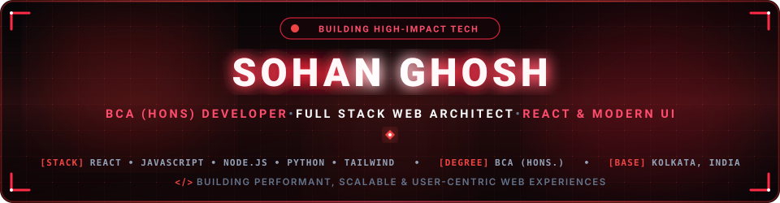
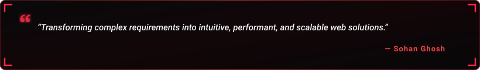

  

  

  
  &nbsp;
  
  &nbsp;
  
  &nbsp;
  

  

---

<h2 align="center">🔴 Executive Summary &amp; Bio</h2>

  

  

  Hey there! I'm <b>Sohan Ghosh</b>, an enthusiastic <b>Full-Stack Web Developer &amp; UI Architect</b> currently pursuing a <b>Bachelor of Computer Applications (BCA Hons.)</b> in Kolkata, India.  
  I specialize in architecting modern component-driven web applications, designing interactive glassmorphic interfaces, and building resilient full-stack systems. From real-time meteorological dashboards and high-throughput employee directories to comprehensive e-commerce platforms, I turn ambitious concepts into seamless, user-centric digital experiences.

  
  &nbsp;
  
  &nbsp;
  
  &nbsp;
  

  💬 <b>Technical Focus:</b> React 19, Modern JavaScript, RESTful APIs, Component-Driven Architecture &amp; Scalable Web Apps. 
  ⚡ <b>Engineering Philosophy:</b> <i>"Driven by innovation, guided by clean architecture, and passionate about shipping software that empowers users."</i>

<table width="100%" border="0" align="center">
<tr>
<td width="50%" align="center" style="padding: 16px; border: 1px solid rgba(239,68,68,0.2); border-radius: 10px; background: rgba(10,10,10,0.5);">
  <h4>🌦️ Flagship Project</h4>
  
<a href="https://github.com/sohanghosh2308-creator/weather-dashboard" target="_blank"><b>NEXUS Weather Dashboard</b></a> Live Geolocation Forecasts, Interactive Maps &amp; Glassmorphism UI

</td>
<td width="50%" align="center" style="padding: 16px; border: 1px solid rgba(239,68,68,0.2); border-radius: 10px; background: rgba(10,10,10,0.5);">
  <h4>💼 Enterprise Systems</h4>
  
<a href="https://github.com/sohanghosh2308-creator/employee-directory" target="_blank"><b>SG Enterprise Directory</b></a> React 19, Full CRUD Operations &amp; Real-Time Search Filtering

</td>
</tr>
<tr>
<td width="50%" align="center" style="padding: 16px; border: 1px solid rgba(239,68,68,0.2); border-radius: 10px; background: rgba(10,10,10,0.5);">
  <h4>🛒 E-Commerce Platform</h4>
  
<a href="https://github.com/sohanghosh2308-creator/online-shopping-cart" target="_blank"><b>BharatCart E-Commerce</b></a> 114+ Products, Indian GST Engine &amp; useReducer State Management

</td>
<td width="50%" align="center" style="padding: 16px; border: 1px solid rgba(239,68,68,0.2); border-radius: 10px; background: rgba(10,10,10,0.5);">
  <h4>📈 Financial Analytics</h4>
  
<a href="https://github.com/sohanghosh2308-creator/expense-tracker" target="_blank"><b>Expense Tracker SPA</b></a> Interactive Recharts Visualizations &amp; LocalStorage Persistence

</td>
</tr>
</table>

---

<h2 align="center">🔴 Featured Project Spotlights</h2>

<table width="100%" border="0" align="center">
<tr>
<td width="100%" align="center" style="padding: 24px; border: 1px solid rgba(239,68,68,0.3); border-radius: 12px; background: #0c0709;">
  <h3>🌦️ NEXUS — Meteorological Weather Dashboard</h3>
  
<i>A responsive, dynamic real-time weather analytics application featuring automatic geolocation tracking, interactive Leaflet.js mapping, multi-metric climate indicators, instant city search, and a modern glassmorphic interface.</i>

  

    <code>HTML5</code> • <code>CSS3 / Glassmorphism</code> • <code>JavaScript ES6+</code> • <code>Leaflet.js Maps</code> • <code>Open-Meteo APIs</code> • <code>Geolocation API</code>
  

   
  

    
    &nbsp;
    
  

</td>
</tr>
</table>

 

<table width="100%" border="0" align="center">
<tr>
<td width="100%" align="center" style="padding: 24px; border: 1px solid rgba(239,68,68,0.3); border-radius: 12px; background: #0c0709;">
  <h3>💼 SG Enterprise — Modern Glassmorphic Employee Directory</h3>
  
<i>A high-performance employee directory single-page application built with React 19 and Tailwind CSS. Features complete CRUD management with modal forms, instantaneous multi-attribute search, department filtering, and a sleek dark glassmorphic design.</i>

  

    <code>React 19</code> • <code>Vite</code> • <code>Tailwind CSS</code> • <code>useState Hooks</code> • <code>CRUD Architecture</code> • <code>Glassmorphism</code>
  

   
  

    
    &nbsp;
    
  

</td>
</tr>
</table>

---

<h2 align="center">🚀 Complete Project Portfolio</h2>

  <table>
    <thead>
      <tr>
        <th>Project Name</th>
        <th>Key Highlights &amp; Architecture</th>
        <th>Tech Stack</th>
        <th>Access Links</th>
      </tr>
    </thead>
    <tbody>
      <tr>
        <td><b>🌦️ NEXUS Weather</b></td>
        <td>Real-time meteorological forecasts, live geolocation, interactive maps</td>
        <td><code>JavaScript</code>, <code>Leaflet.js</code>, <code>CSS3</code></td>
        <td><a href="https://github.com/sohanghosh2308-creator/weather-dashboard">Code</a> • <a href="https://sohanghosh2308-creator.github.io/weather-dashboard/">Demo</a></td>
      </tr>
      <tr>
        <td><b>💼 SG Enterprise</b></td>
        <td>Full CRUD personnel directory, instant search, department filters</td>
        <td><code>React 19</code>, <code>Tailwind CSS</code>, <code>Vite</code></td>
        <td><a href="https://github.com/sohanghosh2308-creator/employee-directory">Code</a> • <a href="https://sohanghosh2308-creator.github.io/employee-directory/">Demo</a></td>
      </tr>
      <tr>
        <td><b>🛒 BharatCart</b></td>
        <td>Full-featured e-commerce cart, 114+ products, Indian GST calculation</td>
        <td><code>HTML5</code>, <code>CSS3</code>, <code>JavaScript</code></td>
        <td><a href="https://github.com/sohanghosh2308-creator/online-shopping-cart">Code</a> • <a href="https://sohanghosh2308-creator.github.io/online-shopping-cart/">Demo</a></td>
      </tr>
      <tr>
        <td><b>📈 Expense Tracker</b></td>
        <td>Single-page expense tracking, interactive Recharts, localStorage</td>
        <td><code>React</code>, <code>Recharts</code>, <code>Tailwind CSS</code></td>
        <td><a href="https://github.com/sohanghosh2308-creator/expense-tracker">Code</a> • <a href="https://sohanghosh2308-creator.github.io/expense-tracker/">Demo</a></td>
      </tr>
      <tr>
        <td><b>🔐 Task Manager &amp; Auth</b></td>
        <td>Protected routing, JWT simulation, task board navigation</td>
        <td><code>React</code>, <code>React Router</code>, <code>JavaScript</code></td>
        <td><a href="https://github.com/sohanghosh2308-creator/task-manager-routing">Code</a></td>
      </tr>
      <tr>
        <td><b>🎓 Student Info Portal</b></td>
        <td>Dynamic record management, props immutability, 10-point CGPA sort</td>
        <td><code>React 19</code>, <code>JavaScript</code>, <code>CSS3</code></td>
        <td><a href="https://github.com/sohanghosh2308-creator/student-info-portal">Code</a> • <a href="https://sohanghosh2308-creator.github.io/student-info-portal/">Demo</a></td>
      </tr>
      <tr>
        <td><b>💻 Developer Portfolio</b></td>
        <td>6 modular components, strict external CSS, responsive layout</td>
        <td><code>React</code>, <code>Vite</code>, <code>Pure CSS</code></td>
        <td><a href="https://github.com/sohanghosh2308-creator/my-portfolio">Code</a></td>
      </tr>
    </tbody>
  </table>

---

<h2 align="center">🛠️ Technical Stack &amp; Competencies</h2>

<b>Core Programming Languages</b>

  

<b>Frontend &amp; UI Architecture</b>

  

<b>Backend, Databases &amp; Services</b>

  

<b>DevOps, Platforms &amp; Engineering Tools</b>

  

<b>📚 Click to Expand: BCA (Hons.) Academic Foundation &amp; Coursework</b>

 

  <table>
    <tr>
      <td><b>Web Technologies &amp; Architecture</b></td>
      <td>Modern React, ES6+, Responsive Layouts, State Machines, RESTful APIs</td>
    </tr>
    <tr>
      <td><b>Database Management Systems (DBMS)</b></td>
      <td>RDBMS, Relational Schema Normalization, SQL Query Optimization, ACID</td>
    </tr>
    <tr>
      <td><b>Data Structures &amp; Algorithms</b></td>
      <td>Arrays, Linked Lists, Stacks, Queues, Binary Trees, Sorting, Optimization</td>
    </tr>
    <tr>
      <td><b>Object-Oriented Programming</b></td>
      <td>Java, C++, Encapsulation, Polymorphism, Inheritance, Clean Architecture</td>
    </tr>
    <tr>
      <td><b>Software Engineering &amp; Methodologies</b></td>
      <td>SDLC, Component Modularity, Agile Practices, Version Control, Testing</td>
    </tr>
    <tr>
      <td><b>Computer Networks &amp; Operating Systems</b></td>
      <td>TCP/IP, HTTP/S, Sockets, Process Management, Concurrency, Shell Scripting</td>
    </tr>
  </table>

---

<h2 align="center">📊 GitHub Analytics &amp; Global Activity</h2>

  
  &nbsp;&nbsp;
  

  

  

---

<h2 align="center">⚡ Contribution Journey</h2>

  

---

<h2 align="center">📬 Let's Connect &amp; Collaborate</h2>

<i>Whether you want to discuss frontend architecture, full-stack software roles, or explore exciting web collaborations — my inbox is always open!</i>

<table border="0" align="center">
<tr>
<td align="center" width="220" style="padding: 18px; border: 1px solid rgba(239,68,68,0.25); border-radius: 12px; background: #0c0709;">
  <a href="https://github.com/sohanghosh2308-creator" target="_blank">
    
      
    
  </a>
    
  <b>Projects &amp; Code</b>
</td>
<td align="center" width="220" style="padding: 18px; border: 1px solid rgba(239,68,68,0.25); border-radius: 12px; background: #0c0709;">
  <a href="mailto:sohanghosh2308@gmail.com">
    
      
    
  </a>
    
  <b>Direct Correspondence</b>
</td>
<td align="center" width="220" style="padding: 18px; border: 1px solid rgba(239,68,68,0.25); border-radius: 12px; background: #0c0709;">
  <a href="https://www.linkedin.com/in/sohan-ghosh-204753399" target="_blank">
    
      
    
  </a>
    
  <b>Professional Network</b>
</td>
<td align="center" width="220" style="padding: 18px; border: 1px solid rgba(239,68,68,0.25); border-radius: 12px; background: #0c0709;">
  <a href="https://x.com/sohanGhosh68133" target="_blank">
    
      
    
  </a>
    
  <b>Updates &amp; Thoughts</b>
</td>
</tr>
</table>

  

